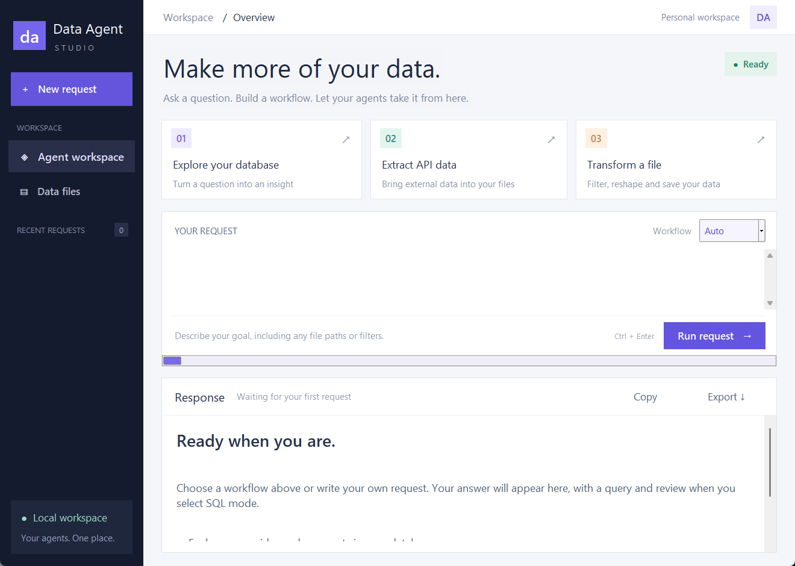
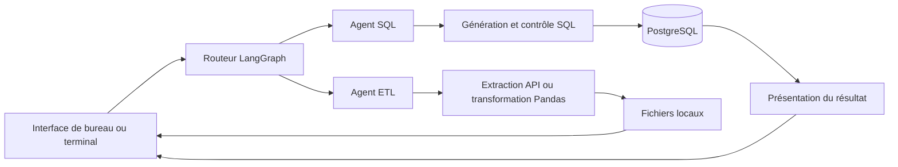

# AI Data Agent

### Un assistant pour explorer une base PostgreSQL et orchestrer des traitements de données en langage naturel.

**Python · PostgreSQL · LangChain · LangGraph · Pandas · Tkinter**

AI Data Agent est un projet étudiant en data et intelligence artificielle. Il associe
un routeur, un agent SQL et un agent ETL à une interface de bureau. L’objectif est
de relier une demande métier à un traitement concret, puis d’en vérifier le résultat.



> **Statut : prototype fonctionnel pour un usage local.** Les tests documentés
> constituent des preuves ciblées ; ils ne représentent pas une certification de
> sécurité ni une garantie de justesse pour toute question.

## Fonctionnalités

| Mode | Rôle |
| --- | --- |
| **Auto** | Classer la demande et la transmettre à l’agent SQL ou ETL. |
| **SQL** | Reformuler une question, construire une requête, obtenir un avis de sécurité, l’exécuter et présenter une réponse. |
| **ETL** | Extraire des données depuis une API ou générer un traitement Pandas pour transformer un fichier. |

L’interface propose des exemples, un historique de session, la copie et l’export
des réponses, ainsi qu’un accès au dossier de données. Les demandes s’exécutent en
arrière-plan. Chaque demande démarre un nouveau traitement : l’historique affiché
ne constitue pas une mémoire conversationnelle persistante.

## Architecture



Les sorties structurées Pydantic encadrent les décisions du routeur et du juge SQL.
L’avis du juge reste une décision de modèle : il ne remplace pas les permissions
du serveur PostgreSQL.

## Installation

### Prérequis

- Python **3.11 ou supérieur** et le gestionnaire de projet **uv**.
- Un compte API OpenAI avec une clé valide et des crédits disponibles.
- PostgreSQL pour les demandes SQL ; les exemples de configuration utilisent le port **5434**.
- Tkinter, généralement inclus dans l’installation Python officielle sous Windows.

Depuis un clone du dépôt :

```powershell
uv sync --locked
Copy-Item .env.example .env
```

Compléter ensuite `.env` avec ses propres paramètres :

```dotenv
OPENAI_API_KEY=remplacer_par_votre_cle_api
host=127.0.0.1
port=5434
database=postgres
user=ai_data_reader
password="remplacer_par_votre_mot_de_passe"
```

`ai_data_reader` désigne un compte de lecture à créer et configurer dans PostgreSQL ;
le projet ne le crée pas automatiquement. Adapter le nom de la base et le port.
Le nom de variable **user** doit correspondre au code : ne pas le remplacer par
`username`, qui entre en conflit avec `USERNAME` sous Windows.

Les modèles et leurs paramètres se configurent dans `utils/llm_pick.py`. Vérifier
que les identifiants choisis sont accessibles au compte API utilisé. Plusieurs appels
peuvent être nécessaires pour une seule demande et leur utilisation est facturée.

### Base et données

Les données locales, les exports et les identifiants ne sont pas distribués dans ce
dépôt. Les exemples SQL métier nécessitent des tables adaptées dans la base configurée.

Le script `feed_db.py` peut charger les CSV métier suivants dans `data/` :
`users.csv`, `vehicles.csv`, `rides.csv`, `payments.csv` et `ratings.csv`.
**Il contient une opération `TRUNCATE ... CASCADE` : ne l’exécuter que sur une base
de démonstration dédiée, après vérification de la configuration.** Le compte de lecture
de l’application n’est pas destiné à initialiser ces données.

Les tests hors ligne et le benchmark synthétique ne nécessitent pas ces CSV métier.

## Utilisation

### Interface de bureau

```powershell
uv run python main.py
```

Sous Windows, après installation des dépendances, il est également possible de
double-cliquer sur **Start workspace.bat**. Choisir un mode, saisir une demande puis
cliquer sur **Run request** ou utiliser **Ctrl + Entrée**.

Exemples à adapter aux données disponibles :

- « Quels sont les noms des dix premiers utilisateurs, triés par identifiant ? »
- « Extraire les résultats de `https://pokeapi.co/api/v2/pokemon` dans `data/extract` au format CSV. »
- « Filtrer `data/extract/extracted_data.csv` pour conserver venusaur et enregistrer le résultat dans `data/transform`. »

### Terminal

```powershell
uv run python main.py --mode SQL --question "Quels sont les dix premiers utilisateurs, triés par user_id ?"
```

Les modes disponibles sont `Auto`, `SQL` et `ETL`. En mode SQL direct, l’interface
affiche aussi la requête générée et le commentaire du juge.

## Validation et résultats

Les mesures suivantes ont été réalisées le **26 octobre 2026**. Elles décrivent un
état du projet et un jeu d’essai limité, pas un taux de réussite universel.

| Vérification | Résultat | Portée |
| --- | --- | --- |
| Régressions hors ligne | **23 / 23** | Routage, contrôle SQL, fichiers CSV/JSON et gestion des erreurs, avec réponses de modèles contrôlées. |
| Connexion PostgreSQL réelle | **Validée** | Connexion et `SELECT 1`. |
| Requêtes produites par les modèles réels | **5 / 5** | Résultats exacts sur des données synthétiques : comptage, filtre, tri, somme et jointure. |
| Routeur avec modèle réel | **2 / 2** | Une demande SQL et une demande ETL. |
| Rôle PostgreSQL restreint | **Écriture refusée** | Vérification d’un `UPDATE` sans ligne correspondante, avec annulation de transaction. |

Le benchmark réel a utilisé **22 appels de modèle**, **4 160 tokens d’entrée** et
**845 tokens de sortie**, pour environ **44 secondes**. L’exécuteur de ce benchmark
était restreint aux tables synthétiques ; il ne s’agit donc pas d’une validation
intégrale de l’exécuteur de production. La justesse du texte final n’a pas été notée.

### Relancer les tests hors ligne

```powershell
uv run python -B tests/reliability_suite.py
```

Cette suite n’appelle pas les API externes et ne modifie pas la base métier.
Elle génère `reports/reliability-results.json` et renvoie un code d’échec si un test échoue.

### Vérifications réelles

```powershell
# Connexion et permissions PostgreSQL ; aucun appel de modèle.
uv run python -B tests/live_postgres_probe.py

# Appels de modèles payants, plafonnés à 24 ; données inventées uniquement.
uv run python -B tests/live_synthetic_evaluation.py
```

Le benchmark crée un schéma temporaire de test, au nom unique, puis le supprime en
fin d’exécution. Son compte d’évaluation doit disposer des permissions nécessaires
à cette création et à ce nettoyage. Utiliser de préférence une base de démonstration.
Un arrêt forcé du processus peut laisser un schéma `reliability_fixture_*` à nettoyer.

Les rapports détaillés sont conservés pour rendre les résultats vérifiables :

- [Tests hors ligne et limites](reports/RELIABILITY.md)
- [Évaluation réelle et constats de sécurité](reports/LIVE_EVALUATION.md)
- [Résultats JSON du benchmark synthétique](reports/synthetic-evaluation-results.json)

Les rapports techniques historiques sont actuellement rédigés en anglais.

## Sécurité et limites connues

- **Compte PostgreSQL :** la configuration locale auditée utilisait un superutilisateur.
  Employer un compte dédié avec `SELECT` sur les seules tables nécessaires, sans
  privilèges d’administration ni d’écriture. Les transactions de lecture et les délais
  d’exécution sont des protections complémentaires, pas une isolation complète.
- **Python généré :** l’agent ETL utilise `exec()` localement, sans environnement isolé.
  Réserver son utilisation à des tâches de confiance sur des données de démonstration.
- **Confidentialité :** en utilisation normale, le contexte SQL peut inclure le schéma,
  des exemples de lignes et des résultats transmis au fournisseur du modèle. Ne pas
  l’utiliser avec des données sensibles sans autorisation et mesures adaptées.
- **Qualité :** l’évaluation réelle ne couvre que cinq questions SQL sur une exécution.
  L’exécution ETL réelle, les attaques, la charge et la stabilité sur plusieurs essais
  n’ont pas été évaluées de façon complète.
- **Extraction :** l’extracteur traite une réponse API, sans pagination automatique.
  Il attend une liste ou un objet contenant une liste `results`.
- **Formats :** CSV et JSON sont couverts par les tests. Parquet nécessite un moteur
  compatible, par exemple `pyarrow`, non inclus dans l’installation de base.
- **Secrets :** `.env` et les données locales sont ignorés par Git. Ne jamais publier
  une clé API, un mot de passe ou des exports contenant des informations personnelles.

## Organisation du dépôt

```text
AI Data Agent/
├── main.py                 # Interface de bureau et accès terminal
├── agents/                 # Routeur, agent SQL et agent ETL
├── Models/schema.py        # États du graphe et sorties structurées
├── utils/                  # Modèles, PostgreSQL et outils ETL
├── tests/                  # Régressions et évaluations réelles
├── reports/                # Résultats, preuves et limites
├── docs/interface.png      # Aperçu de l’interface
├── feed_db.py              # Chargement de données de démonstration
├── .env.example            # Configuration sans secrets
├── pyproject.toml          # Métadonnées et dépendances
└── uv.lock                 # Versions verrouillées
```

## Évolutions envisagées

- Isoler l’exécution du Python généré et vérifier les fichiers de sortie.
- Élargir le jeu de questions annotées et répéter les évaluations.
- Ajouter une validation ETL de bout en bout, avec contrôles des types et des valeurs.
- Améliorer la journalisation, le suivi des coûts et la gestion des tâches longues.

## Auteur

Projet développé par **Ilyass Rbaai**, dans un parcours d’apprentissage en data et IA.
Les choix techniques, les tests et les limites sont documentés pour faciliter la
relecture et la reproduction.

## Licence

Aucune licence de réutilisation n’est actuellement fournie. Une licence pourra être
ajoutée par l’auteur selon les droits de réutilisation qu’il souhaite accorder.
